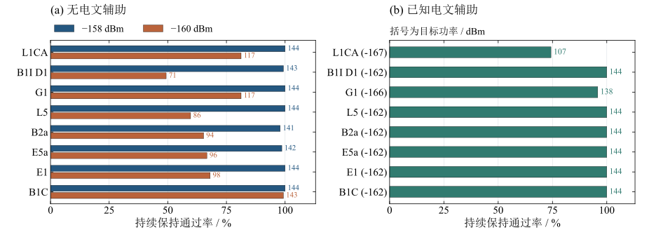
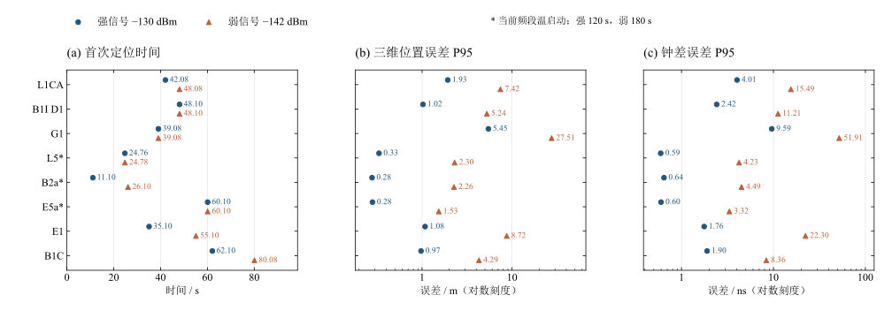

# 跟踪与定位仿真结果

## 1 结果概览

软件仿真已覆盖八种信号的捕获移交后牵引、弱信号持续保持，以及模拟多星IQ到位置解算的闭环。主要结果如下。

| 验证内容 | 已测结果 | 适用条件 |
|---|---|---|
| 常规牵引与同步 | 八信号各144/144通过 | 原始总功率−135 dBm，初码差±0.125／±0.25 chip |
| 无电文辅助保持 | −158 dBm下，1200 s平台通过1146/1152；−160 dBm下为822/1152 | 先建立同步，再缓降功率；不同信号存在明显差异 |
| 已知电文辅助保持 | 各信号目标功率下，1200 s平台通过1109/1152 | L1CA为−167 dBm、G1为−166 dBm，其余为−162 dBm；辅助符号正确且持续可用 |
| 多星定位闭环 | 八信号强、弱入口均获得位置解 | 强入口−130 dBm，弱入口−138～−148 dBm，按信号分别设置 |
| 定位精度 | 强信号三维误差P95为0.266～5.692 m；弱信号为1.316～110.135 m | 上海静态模拟接收机，各信号各功率一个代表场景 |

上述结果均为软件仿真，不是射频实测。−160／−167 dBm表示已同步后的持续保持条件，不表示可以在同等功率下直接捕获、独立解调电文或首次定位。

## 2 仿真范围与统计口径

| 项目 | 跟踪仿真 | 定位仿真 |
|---|---|---|
| 输入层次 | 理想相关值PDI闭环，相关值含独立噪声 | StarGen模拟多星IQ，经量化、捕获、整数混频相关进入跟踪 |
| 信号 | L1CA、B1I D1、G1、L5、B2a、E5a、E1、B1C | 同左，不含B1I D2 |
| 样本规模 | 每信号、每类功率／辅助条件144例，共3456例 | 每信号强、弱功率各一个独立IQ场景 |
| 运动设置 | 静态及±0.1、±0.2、±0.5、±1 Hz/s | 接收机静止，卫星运动仍产生多普勒和变化率 |
| 主要指标 | 正确同步、持续保持、频差、码差、退出及恢复 | 首次定位时间、位置误差、有效星历与失败通道 |

跟踪矩阵的144例由**16个种子×9档多普勒变化率**组成，前8个种子使用强入口，后8个使用中弱入口。不同变化率复用同一组种子，不等于144个独立噪声种子。三类条件分别为无辅助−158 dBm、无辅助−160 dBm、已知电文辅助目标功率，合计8×3×144＝3456例。

功率均指原始复合信号总功率，参考噪声谱密度为−170 dBm/Hz。−158／−160 dBm分别对应总载噪比12／10 dB-Hz。无辅助时L5、B2a、E5a、E1的50%导频在−160 dBm总功率下约为7 dB-Hz，B1C的75%导频约为8.75 dB-Hz。擦除公开二次码不算导航电文辅助。

## 3 跟踪仿真结果

### 3.1 输入过程与通过判据

| 阶段 | 仿真输入 |
|---|---|
| 建立同步 | 总载噪比35 dB-Hz，即−135 dBm，运行60 s |
| 功率缓降 | 用320 s降至目标功率，目标平台从第380 s开始 |
| 目标保持 | 持续1200 s，分别统计前300、600、1200 s |
| 功率恢复 | 用20 s恢复至35 dB-Hz，再保持40 s |
| 总时长 | 每例1640 s，提前退出仍保留在分母中 |
| 初始频差 | L5类覆盖±2.5／6.25／7.5／12.5 Hz，其余覆盖±6.25／12.5／31.25／62.5 Hz |
| 初始码差 | ±0.125／±0.25 chip，覆盖非零初始频码差 |

某一检查点通过须同时满足：边界同步正确、到该时刻未退出、目标平台数据完整，且对应平台前缀的频差RMS≤5 Hz、绝对频差P95≤10 Hz。码相位精度单列，不作为本批极限保持的额外通过门限。

三个检查点来自同一次运行，不是重新初始化的三批实验。后段频差收敛可能使累计误差重新满足判据，因此通过数可能回升；已经退出的案例不会重新计为通过。平台完成后在恢复阶段退出，与平台内保持失败分开统计。

### 3.2 常规牵引与同步

取长测最初60 s的常规移交段，每个信号16种子×9档变化率，共144例。八种信号均为**144/144**，合计1152/1152。

此结果对应−135 dBm和±0.125／±0.25 chip初码差。强、中弱入口均有覆盖，但中弱入口的配置不等于弱功率输入；该结果不能代替极限捕获功率或更大初码差的牵引资格。

### 3.3 无电文辅助持续保持

图1 八信号1200 s持续保持结果，柱端为通过数，各柱分母均为144

**原始总功率−158 dBm**

| 信号 | 300 s通过 | 600 s通过 | 1200 s通过 | 1200 s通过率 |
|---|---:|---:|---:|---:|
| L1CA | 144/144 | 144/144 | 144/144 | 100.0% |
| B1I D1 | 141/144 | 143/144 | 143/144 | 99.3% |
| G1 | 143/144 | 144/144 | 144/144 | 100.0% |
| L5 | 144/144 | 144/144 | 144/144 | 100.0% |
| B2a | 144/144 | 144/144 | 141/144 | 97.9% |
| E5a | 143/144 | 142/144 | 142/144 | 98.6% |
| E1 | 144/144 | 144/144 | 144/144 | 100.0% |
| B1C | 144/144 | 144/144 | 144/144 | 100.0% |
| 合计 | 1147/1152 | 1149/1152 | 1146/1152 | 99.5% |

**原始总功率−160 dBm**

| 信号 | 300 s通过 | 600 s通过 | 1200 s通过 | 1200 s通过率 |
|---|---:|---:|---:|---:|
| L1CA | 122/144 | 118/144 | 117/144 | 81.3% |
| B1I D1 | 94/144 | 87/144 | 71/144 | 49.3% |
| G1 | 116/144 | 130/144 | 117/144 | 81.3% |
| L5 | 128/144 | 109/144 | 86/144 | 59.7% |
| B2a | 132/144 | 116/144 | 94/144 | 65.3% |
| E5a | 130/144 | 111/144 | 96/144 | 66.7% |
| E1 | 125/144 | 114/144 | 98/144 | 68.1% |
| B1C | 144/144 | 144/144 | 143/144 | 99.3% |
| 合计 | 991/1152 | 929/1152 | 822/1152 | 71.4% |

−158 dBm下整体保持较稳定。−160 dBm下，B1C本批长期保持较好，B1I D1和L5仍是主要短板。各变化率的汇总不能代替单一场景结论，也不能用其他信号的成绩抵消某一信号的不足。

### 3.4 已知电文辅助持续保持

辅助组从40 s起提供正确已知导航符号，由跟踪状态决定实际使用时刻。数据型擦除已知导航位；导频信号在专用辅助状态下合并数据与导频Prompt。

| 信号 | 原始总功率/dBm | 300 s通过 | 600 s通过 | 1200 s通过 | 1200 s通过率 |
|---|---:|---:|---:|---:|---:|
| L1CA | −167 | 137/144 | 128/144 | 107/144 | 74.3% |
| B1I D1 | −162 | 144/144 | 144/144 | 144/144 | 100.0% |
| G1 | −166 | 142/144 | 142/144 | 138/144 | 95.8% |
| L5 | −162 | 144/144 | 144/144 | 144/144 | 100.0% |
| B2a | −162 | 144/144 | 144/144 | 144/144 | 100.0% |
| E5a | −162 | 144/144 | 144/144 | 144/144 | 100.0% |
| E1 | −162 | 144/144 | 144/144 | 144/144 | 100.0% |
| B1C | −162 | 144/144 | 144/144 | 144/144 | 100.0% |
| 合计 | 各信号目标 | 1143/1152 | 1134/1152 | 1109/1152 | 96.3% |

L1CA −167 dBm与G1 −166 dBm的最低目标为静态保持300 s。本表保留完整九档变化率及1200 s延长保持，包含超出该最低目标的压力场景。不同信号的辅助目标功率不相同，不能按此表直接比较同功率下的辅助增益。

### 3.5 退出与恢复

| 条件 | 降至目标前退出 | 1200 s平台内退出 | 完成平台但频差超标 | 平台通过后恢复退出 |
|---|---:|---:|---:|---:|
| 无辅助−158 dBm | 0 | 6 | 0 | 0 |
| 无辅助−160 dBm | 0 | 313 | 17 | 3 |
| 已知电文辅助目标 | 0 | 43 | 0 | 0 |

无辅助−160 dBm的17例频差超标分布为L1CA 4例、B1I D1 8例、G1 5例。恢复阶段的3例退出分别来自G1、L5、E1，均已完成1200 s平台，包含恢复的全程通过数为819/1152。

“退出”不直接等于“失锁误报”。本批没有关闭退出判决后的对照续跑，不能仅凭退出前的局部误差区分真实失稳与统计误退出。

## 4 定位仿真结果

### 4.1 场景与处理过程

| 项目 | 设置 |
|---|---|
| 虚拟接收位置 | 上海，北纬31.2304°、东经121.4737°，椭球高20 m |
| 接收机初始钟差 | +2 ms |
| 信号与轨道 | 广播星历驱动的静态多星基带IQ，含导航电文 |
| 接收处理 | 实际执行软件捕获、整数混频相关、跟踪、解调PLL、电文校验和星历收集 |
| 观测与定位 | 每20 ms形成观测量，由接收电文确定时间和星历，再解算位置与钟差 |
| 真值使用 | 发生器坐标与轨道真值仅用于生成信号和事后评价，不用于接收端直接求解 |
| 强入口 | 每星原始总功率−130 dBm，运行120 s |
| 弱入口 | 按信号的捕获灵敏度设置，见结果表 |
| 噪声种子 | 2026093001，每信号、每功率一个独立IQ场景 |

首次定位时间从IQ首样点开始，包含捕获移交及后续接收时间，不是仿真CPU耗时。已给定可见PRN列表和粗日期，G1另给定FDMA频道，因此不称为全星座盲冷启动。

L5、B2a、E5a采用温启动：使用前级频段实际跟踪60 s后换算的多普勒辅助，不使用发生器频率真值。表中的首解时间只计当前频段，**不含前级60 s准备时间**。

弱L1CA、B1I、G1、B1C运行600 s，弱L5、B2a、E5a运行180 s。E1使用600 s已接收数据的因果重放，并有200 s完整IQ复验。重放按接收顺序处理历史符号和NCO记录，不使用未来数据；同一IQ的重放不是新的独立样本。

### 4.2 首次定位时间与位置精度

图2 八信号首次定位时间与三维位置误差P95，星号表示温启动，括号为弱信号功率

P95表示95%的已记录有效定位历元，其三维误差不超过该值。误差按解算坐标与上海真值的三维欧氏距离计算，不用求解器“返回成功”代替精度检查。

| 信号 | 弱功率/dBm | 强首解/s | 弱首解/s | 强三维P95/m | 弱三维P95/m |
|---|---:|---:|---:|---:|---:|
| L1CA | −148 | 42.08 | 318.08 | 1.924 | 24.524 |
| B1I D1 | −146 | 48.10 | 138.14 | 1.005 | 13.377 |
| G1 | −148 | 65.08 | 365.08 | 5.692 | 110.135 |
| L5，温启动 | −142 | 24.76 | 24.78 | 0.310 | 2.283 |
| B2a，温启动 | −138 | 17.10 | 17.10 | 0.266 | 1.316 |
| E5a，温启动 | −142 | 60.10 | 60.10 | 0.283 | 1.534 |
| E1 | −143 | 35.10 | 115.10 | 1.091 | 10.240 |
| B1C | −138 | 62.10 | 62.10 | 0.960 | 4.086 |

八信号均完成强、弱入口的位置解算。弱L1CA、G1本例首解超过300 s，弱G1精度明显低于其余场景。各信号的功率、星座几何、运行时长和启动方式不同，本表用于展示已打通的能力，不能作为同条件性能排名或TTFF概率分布。

G1采用最终字符串重复确认和帧完整性检查结果，强入口65.08 s来自同一IQ产物的因果解码与定位重放；弱600 s完整IQ与最终检查重放结果一致。E1表中弱P95 10.240 m对应600 s重放，200 s完整IQ复验的首解同为115.10 s、P95为7.553 m，两种时长的精度不混用。

### 4.3 弱入口的单星失败与限制

| 信号 | 有效星历/搜索卫星 | 未完成项 |
|---|---:|---|
| L1CA | 8/9 | 1颗未形成可用星历，整体首解318.08 s |
| B1I D1 | 9/10 | PRN26位同步超时 |
| G1 | 5/7 | PRN14、24保持跟踪，但未收齐重复确认的星历 |
| L5 | 4/7 | PRN9、26、28未通过捕获 |
| B2a | 10/11 | PRN32未通过捕获 |
| E5a | 6/9 | PRN13、15、23未通过捕获 |
| E1 | 7/9 | PRN21、28未通过捕获 |
| B1C | 9/11 | PRN24、31同步超时，移交码差约0.39／0.40 chip，超出当前常规±0.25 chip范围 |

G1最终5颗星历的轨道和钟参数与对应广播版本一致。弱入口的各星伪距RMS约11～14.5 m，使用4～5颗卫星时几何精度因子较差，三维P95达到110.135 m。因此该场景证明定位链路能够运行，但不代表高精度定位。

## 5 结论与后续验证重点

- **常规条件下统一流程已经跑通。** 八信号常规牵引各144/144通过，多星定位分别完成强弱功率代表场景。
- **−158 dBm无辅助保持较稳定，−160 dBm仍有差异。** 后续优先分析B1I D1和弱导频的长期保持失败，不把总体比例当作每个信号都达标。
- **已知电文辅助能支持更低功率保持。** L1CA −167 dBm、G1 −166 dBm等目标已有软件仿真证据，但依赖正确辅助符号及适当动态条件。
- **定位与极弱保持是两种能力。** 本批弱定位功率为−138～−148 dBm，不能据此声称−160／−167 dBm下也能独立获得首次定位。

本批尚未覆盖真实射频、现场遮挡、多径、干扰、错误导航符号辅助，以及多种子定位TTFF分布。定位场景未加入TCXO或大气误差。B1I D2不包含在上述八信号矩阵中。

## 6 数据依据与版本范围

| 结果 | 数据依据 | 版本范围 |
|---|---|---|
| 牵引与保持 | 八信号缓降与长时间极限灵敏度实验，3456例及216个分组记录 | 跟踪源基线`1e10c19`，相关域闭环 |
| 八信号定位 | 强弱入口IQ接收日志、位置输出及最终因果重放 | 导航定位实验分支成果，不能等同于master已发布完整定位功能 |
| G1最终定位 | 重复信息确认与帧位置检查后的强弱结果 | 强首解65.08 s；弱首解365.08 s |
| 图表与本表 | 机器摘要按信号、功率、变化率重算，位置日志重算三维P95 | 整理日期2026-11-10，无新增仿真 |

G1同步整改已在后续`462c24d`合入master，但本文的3456例历史保持矩阵未针对该提交整体复跑，不以旧结果声明当前版本完成全部资格验证。

[结果数据与来源指纹](实验数据/跟踪与定位仿真结果.json)保存表中计数、各变化率分组、定位指标及原始来源摘要。完整逐例输入、状态变化和失败日志保留在本地实验归档；仓库内图表使用相对路径，可直接在Obsidian或GitHub阅读。
